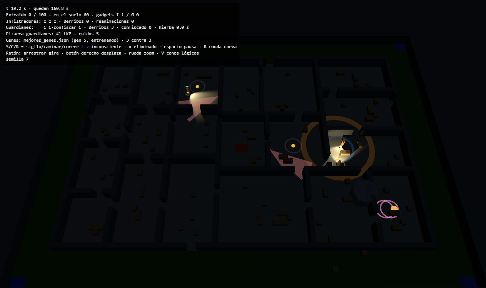

# Anti-Stealth — guards vs infiltrators, with an AI that learns

> A small stealth game that plays itself. Three guards defend a big house at night with flashlights, cameras and
> sensors; three infiltrators try to steal the loot and get out through a corner of the garden. Nobody is controlled
> by a person: both teams are run by an AI, and a genetic algorithm trains them by making them play thousands of
> rounds against each other. It runs in the browser (plain JavaScript + Three.js), and the training runs in Node
> without any window.



## The story

It started as a map I painted in Godot for a fog-of-war idea. Then I wanted to see if I could make two teams fight
on it without me touching anything, and it kind of got out of hand.

The first version (v1) had the AI written by hand: "if you see a guard, run", "if the bag is half full, go and
extract", and a lot of numbers (we called them genes) that the genetic algorithm tuned. It worked, but every time I
watched a round I saw something obvious they didn't do (guards that never defend the loot, infiltrators that run
straight into a flashlight...) and I had to program it. That list never ends.

So this is v2: each team now has a small **neural network** that decides what to do. It starts playing exactly like
v1 and learns, by training, when it is better to do something else.

I would really like to try reinforcement learning one day, where the AI learns everything from scratch just by
playing, without me giving it a menu of actions. But honestly it feels too complex for my level right now, and from
what I read it needs millions of games to learn anything useful. I don’t really want to leave my PC on day and night
training an AI, so for now the network only learns to choose between things the game already knows how to do.

## How I made it (being honest)

I didn't write most of this code by hand. The code was written with an AI coding assistant (Claude Code). My part was
everything around it: I came up with the game and its rules, decided how each team should behave, watched a lot of
rounds, found what was broken or didn't make sense, figured out why, and decided what to change. Basically I was the
designer and the tester, and the AI was the one typing.

That turned out to be most of the work. The AI wrote code that passed its own tests and still did stupid things in
the game, and somebody had to notice.

## Problems I found along the way

The fun (and annoying) part of an AI that trains itself is that it finds every hole in your rules. Some of the ones I
caught by watching rounds:

- **Smoke was a "get out of jail" button.** Infiltrators threw smoke on themselves the moment they were about to be
  stunned. The genetic algorithm found it before I did: every win used smoke. Now smoke takes 1.5 s to come out, makes
  noise, and guards right next to you can still see you.
- **Everybody ran everywhere.** Running was free, so both teams learned to run all the time. That's why there is a
  stamina bar now.
- **Light went through walls and boxes.** The flashlight shadows were leaking at the bottom of walls. It was a
  rendering detail (which side of the blocks casts the shadow), but in a game about darkness it ruins everything.
- **Infiltrators "trembled" in the light.** When a guard saw them they stood up to run, behind a box they stopped being
  seen, so they crouched again, so they were seen again... several times per second. They needed to commit to a decision
  for a moment.
- **Two guards in the exact same spot, looking the same way.** They all went to the same alert and nothing stopped them
  from overlapping. Now agents collide, and when several go to an alert they spread around it.
- **EMPs through walls.** An infiltrator walking outside switched off a camera inside the house that couldn't even see
  him, just because it was close. Now it only makes sense against a gadget that is actually in your way.
- **Guards never defended the loot.** Not because it was a bad idea, but because it simply wasn't an option they had.
  That's what pushed me to v2: I can't write every case by hand.
- **Two bags were enough.** With a big bag, two trips won the round, and three minutes is a lot of time for two trips.
  Now the bag is smaller and they need three, which gives the guards more chances to catch them. But then carrying a
  full bag (you went 25 % slower) hurt a lot more, because now they carry it three times: the infiltrators only won
  about 1 round in 4. Now a full bag only makes you 10 % slower.
- **Rewarding the wrong thing.** When I added points during the round, the first idea was to reward guards for every
  second they had an infiltrator in sight. But then the easiest way to get points is to just watch him from far away
  and never catch him. Now they only get points while they are actually close enough to stun.
- **Two sensors on top of the loot.** Guards put their gadgets where "a lot of routes pass", and the loot point is
  where every route ends, so two sensors ended up one on top of the other, right on the loot. They warned when the
  infiltrator was already leaving, and the second one was useless. I tried to fix it by placing them where they would
  have caught the most infiltrators in recorded rounds, but then I saw sensors on the doors: lots of infiltrators pass
  there, but when they are leaving, detecting them is useless. Every rule I (or the AI that writes the code) came up
  with had a case like that. So now nobody tells the guards where to put their gadgets: where each one goes is part of
  their genes, and the genetic algorithm keeps the places that make them win.
- **Twenty seconds of nothing.** Guards finished placing their gadgets in about 10 of the 20 seconds of preparation.
  Now it's 12. If a guard picks a spot he can't reach in time, he loses that gadget, and that's something they learn too.
- **Training more didn't add up.** Every training started from zero, so nothing was learned from the one before. When
  I made it continue from the last one, the infiltrators went from winning 47 % to 57 % and I thought the guards had
  gotten worse. They hadn't: putting the new teams against the old ones, the new infiltrators beat the old guards 86 %
  of the time, and the new guards held the old infiltrators to 32 %. Both had improved, the infiltrators just a bit
  more. The win rate tells you if the game is fair, not if the teams are getting smarter.
- **Teams going in circles.** Each team only learns against the rival it has right now, so it can forget how to beat
  older styles. Now there's a "hall of fame": the champion of every generation is saved, and everyone also has to play
  against old champions. It's kept between trainings, so every training continues the last one.
- **Rock, paper, scissors.** For a while I only checked that the new teams beat the ones from the training before.
  After several "better" trainings in a row, I put the latest teams against older ones and they weren't better at
  all: beating the last rival doesn't mean you beat everyone (guards went all cameras, infiltrators learned to beat
  cameras, and so on). Now a training only counts if the new teams do at least as well against several old champions.

To know if a change made things better or worse I didn't trust my eyes alone: `equilibrio.js` plays a few dozen rounds
and gives the win rate of each team, and I tuned the rules until it was around 50/50 between trained teams. To know if
the teams actually learned something, `comparar.js` makes the new teams play against the old ones.

## Run it

You need Python (only for a tiny local server) and a browser. For training and tests you also need Node.js.

```
python simulador/herramientas/servidor.py
```

Then open `http://localhost:8123/simulador/index.html`.

Opening `index.html` directly as a file also works, but then the browser can't read the trained genes and the teams
play with the default ones.

- `?n=5` in the URL plays 5 vs 5 instead of 3 vs 3; `?semilla=123` repeats the same round.
- Mouse: drag to rotate, right button to move, wheel to zoom.
- Keys: space pauses, R starts a new round, V shows the vision cones the game really uses, Tab hides the info panel.

## What happens in a round

- **Preparation (12 s, the clock doesn't run):** guards place their gadgets. Cameras go on walls and sweep from side to
  side; sensors are hidden on the floor. Where each one goes, which way the cameras look and how many cameras vs
  sensors they use is all in their genes, so it's learned by training.
- **The round (3 minutes, +30 s after the first extraction):** infiltrators come in from the four corners of the
  garden. There are three loot points deep inside the house; they have to carry 100 to the corners to win, and a bag only holds 35,
  so that's at least three trips (a full bag makes you 10 % slower). Guards win
  when time runs out or when all infiltrators are eliminated.
- **Seeing and being seen:** everything is in the dark. Guards see with their flashlight (a cone that gets weaker with
  distance); infiltrators see further but with a narrow cone, and they notice any flashlight they have in sight. Walls
  block everything; boxes only hide you if you are crouched. Each team shares what it sees and hears instantly, like
  a radio.
- **Noise:** walking and running make noise rings (you can see them); crouched you are almost silent.
- **Stamina:** running uses it (about 5 seconds from full), walking slowly gets it back and standing still or crouched
  gets it back faster. With an empty bar you can't run until you recover a bit. It's the blue bar above everyone.
- **Fighting:** a guard who keeps an infiltrator in his light for 1.5 s stuns him. An infiltrator who stays behind a
  guard without being seen knocks him down. People wake up after 20 s, or earlier if a teammate revives them. After 4
  knockdowns you are out.
- **Gadgets:**
  - *Camera* — sees far but narrow and sweeps, needs 1.5 s to raise the alarm, can be switched off by an infiltrator
    who stands next to it (and switched back on by a guard who sees it's off).
  - *Sensor* — hidden, 360°, ignores smoke and darkness, but only says "something happened here" and then recharges.
  - *Smoke* — blocks guards and cameras, but infiltrators see through it.
  - *Decoy* — fake noises to pull guards away.
  - *EMP* — switches off nearby guard gadgets for 10 s (only worth it against one that is actually in your way).
  - Infiltrators get a new gadget every 30 s.

All the numbers are in `simulador/config.js`.

## The AI part

Every agent has a small brain: a neural network with one hidden layer. Every quarter of a second it looks at what the
agent knows (am I being seen? how far is the closest guard I know about? am I carrying loot? is the next part of my
path lit? how much time is left?...) and picks one action from a menu and how to move (crouched, walking or running).

- **Infiltrators:** do the normal routine, go for the loot, go and extract, hide, wait still, attack a guard from
  behind, switch off a camera, throw smoke, throw a decoy, or use an EMP.
- **Guards:** do the normal routine, **guard the loot that is in danger**, cut the exit door, search hiding spots, wait,
  patrol, investigate the last alert, **ambush an extraction corner**, or **chase whoever was seen carrying loot**.

The "normal routine" is the whole v1 AI. With all the network weights at zero it always picks the routine, so a fresh
network plays like v1, and training only has to learn when to change.

The weights of the network are just more genes. The genetic algorithm takes a population of guard brains and one of
infiltrator brains, makes them play against each other, keeps the best, mixes them and mutates them, and repeats.
Winning is what counts most (1000 points), but only looking at who won tells the algorithm very little, so a round
also gives small points for good things done along the way: infiltrators lose a bit for every second a guard or a
camera sees them, and guards earn a bit while they are about to stun someone and while they stay near loot that is
still there (and lose some for every second a camera stays switched off). How fast you win doesn't matter.

```
cd simulador
node pruebas/evolucionar.js 1 40 20 2      # seed, generations, population, rivals (from zero)
CONTINUAR=1 node pruebas/evolucionar.js 2 40 20 2   # continue from the last training and its hall of fame
node pruebas/comparar.js new.json old.json [older.json ...]   # did they learn? new teams against old ones
node pruebas/equilibrio.js                 # win % for each team, ~1 minute
node pruebas/acciones.js                   # what the networks actually choose
```

Training plays the rounds on several CPU cores at the same time (same result as with one, just faster): a full run
like the one above takes about 15 minutes on my PC. It writes `simulador/mejores_genes.json` after every generation,
so you can stop it whenever you want; the page loads it next time. The hall of fame goes to `simulador/salon_fama.json`.

## What doesn't work (yet)

- Training is short (minutes to an hour, not days), so the networks are still pretty basic. I'm pretty sure a person
  who knows the rules would beat them.
- 5 vs 5 is not balanced; everything was tuned for 3 vs 3.
- The teams know things a bit too well: what one sees, the whole team knows instantly.

## Making it yours

- **The map** is `mapa_casa.js`. You can edit it in Godot 4: open the `editor_mapa` project, select the GridMap, tick
  *pintar*, change the blocks and tick *exportar*. Or generate a new house: `node simulador/herramientas/generar_casa.js 8`
  (another seed gives another house).
- **Rules and numbers:** `simulador/config.js`.
- **Tests:** `node simulador/pruebas/pruebas.js` (about a minute) and `node simulador/pruebas/pruebas_genetico.js`.

## Credits

- [Three.js](https://threejs.org/) for the 3D view.
